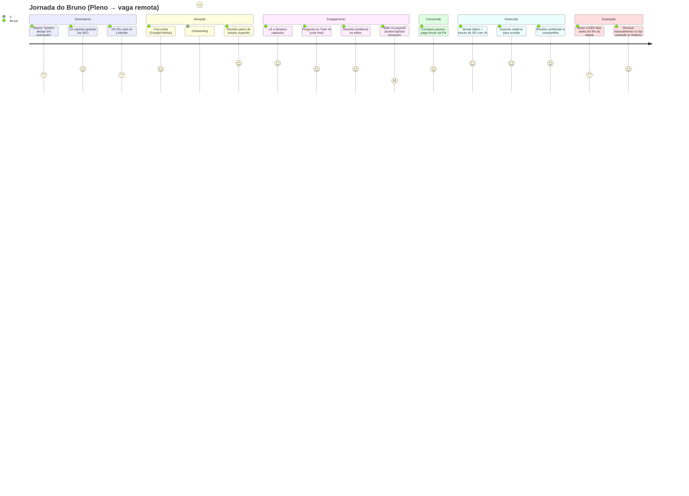
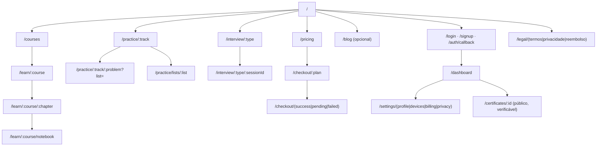
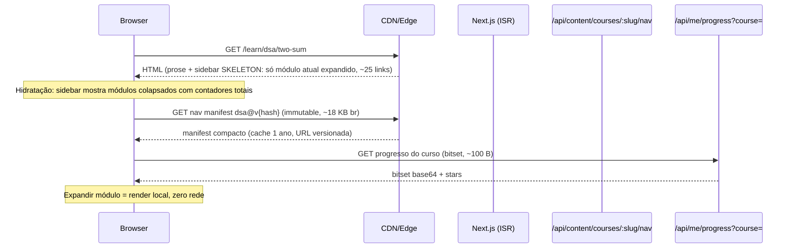

# FASE 1 — Briefing de Produto & Arquitetura de Informação

> **Produto (nome provisório):** `CodeForge` — trocar quando definido. Identificadores de código usam o slug `codeforge`.
> **Referência funcional:** AlgoMaster.io (analisado em 2026-10-29).
> **Premissas assumidas (campos não preenchidos no prompt):** moeda **BRL (Pix + cartão) e USD (Stripe)**; nome provisório acima.

---

## 0. Engenharia reversa da referência (o que foi observado)

| Dimensão | Observado em algomaster.io | Implicação para o CodeForge |
|---|---|---|
| Catálogo | 22 cursos em `/learn` (DSA, System Design Fundamentals, SD Interviews, LLD, Concurrency, SQL, Behavioral, Job Search, AI Eng., GenAI SD, ML SD, OS, Redes, Microservices, API Design, Kafka, Java/Python/C++/C#/Go, Git) | O modelo de dados precisa suportar dezenas de cursos heterogêneos; o MVP sai com 4 trilhas núcleo |
| Escala de conteúdo | DSA: **771 capítulos** (~30 módulos; Graphs 82, DP 92). System Design: **180 capítulos / 20 módulos** | Sidebar com 700+ itens: **não pode** ir inteira no HTML inicial (ver §6) |
| Hierarquia | Curso → Módulo (contador `0/N`) → Subgrupo opcional (ex.: "Basic Prefix Sum") → Capítulo | Exatamente a hierarquia pedida; subgrupo é opcional |
| Tipos de capítulo | Artigo, problema (link para `/practice/dsa/{slug}` + LeetCode), quiz ("Complexity Quiz – Easy"), crash course de linguagem, "Exercises" ao fim de módulos de SD | `chapter.kind ∈ {lesson, problem, quiz}` + `exercise_set` como variante de quiz/problema |
| Rotas | `/learn/{course}/{chapter}`, `/practice/{track}`, `/practice/dsa/{slug}?list=am-300`, `/interview/{coding\|system-design\|low-level-design}`, `/premium`, `/dashboard`, `/animations`, `/roadmaps`, `/leaderboard`, `/resume` | Mapa de rotas compatível em §5 |
| Prática | DSA 600, SD 150, LLD 107, Concurrency 50, por empresa; listas curadas 600/300/150/75 por tempo de preparo; filtros Unsolved/Starred, "Pick Random", barras Easy/Medium/Hard | "Listas" são entidade própria (N:N com problemas) |
| Leitor | Listen Mode (áudio + highlight por parágrafo), Ask AI, highlights multicor, notas inline, Course Notebook exportável, quizzes (múltipla escolha, completar código, associação), ajustes de fonte/altura de linha/largura/fullscreen, tema escuro, "On this page", prev/next, `?book` (modo livro), tempo de leitura, "Updated em" | Escopo do Reader Layout (Fase 5) |
| Monetização | `/premium`: Mensal R$199, Anual R$399, Vitalício R$799 — **pagamento único, sem renovação automática** | Modelo de "passes" com `access_expires_at` |
| Free vs Premium | "Parte significativa gratuita"; premium gateia áudio, conceitos premium, animações, IA ilimitada | Gating por capítulo + por feature + cota de IA |
| Stack | Next.js (`/_next/image`), Vercel (`dpl_` nos assets); sidebar aparenta vir no HTML inicial | Melhoramos: sidebar sob demanda |

---

## 1. PRD

### 1.1 Problema
Engenheiros que se preparam para entrevistas consomem conteúdo fragmentado: LeetCode (problemas sem teoria), livros/vídeos (teoria sem prática), ferramentas separadas para mock interview, notas espalhadas. Não há um **único ambiente de estudo prolongado** que una teoria → prática → simulação → revisão, com progresso mensurável e **conteúdo de qualidade em português**.

### 1.2 Proposta de valor
> **"Domine padrões, não problemas. Teoria, prática executável e entrevistas simuladas com IA — em um só lugar, feito para estudar por horas."**

Pilares:
1. **Aprendizado por padrões** — cada problema pertence a um padrão ensinado antes dele.
2. **Loop fechado** — Ler → Ouvir → Perguntar à IA → Resolver no editor → Quiz → Mock → Revisar notas.
3. **Ergonomia de estudo longo** — leitor tipográfico, temas anti-fadiga, áudio sincronizado.
4. **Preço justo e sem armadilha** — passes de acesso único (sem renovação automática), Pix nativo.
5. **PT-BR first, EN-ready** — diferencial competitivo direto contra a referência.

### 1.3 Personas

| Persona | Perfil | Objetivo | Dores | Métrica de sucesso |
|---|---|---|---|---|
| **P1 — Júnior em transição** (Ana, 24) | 0–2 anos, bootcamp/faculdade | Primeiro emprego / vaga em big tech BR | Não sabe por onde começar; Big-O e recursão travam | Completa DSA Warmup + lista 75 |
| **P2 — Pleno mirando exterior** (Bruno, 29) | 3–6 anos, backend, inglês intermediário | Vaga remota em USD | Nunca fez System Design formal; precisa mock em inglês | ≥ 5 mocks SD com nota ≥ 7 |
| **P3 — Sênior "enferrujado"** (Carla, 36) | 8+ anos, sem entrevistar há anos | Staff/Senior em 1–3 meses | Pouco tempo; quer revisão rápida e direcionada | Lista 150 + LLD em 6 semanas |
| **P4 — Estudante de longo prazo** (Diego, 21) | Graduação em CC | Base sólida para estágios | Orçamento baixo | Uso recorrente do tier free → converte no Vitalício |
| **P5 (secundária) — Recrutador/Educador** | Bootcamps, mentores | Indicar trilhas | Sem visão de progresso dos alunos | (pós-MVP: planos B2B/turmas) |

### 1.4 Jornada do usuário (P2 — caso principal)



Momentos-chave instrumentados (funil): `visit_chapter_public → signup → onboarding_done → first_highlight → first_submission → paywall_view → checkout_start → purchase → d7_return → mock_completed → certificate_issued → pass_expiring_notice → repurchase`.

### 1.5 Mapa de features (MoSCoW)

**MUST (MVP)**
- Auth (email magic link + Google + GitHub), sessões por dispositivo com limite (anti-compartilhamento).
- Catálogo, curso, módulo, grupo, capítulo (lesson / problem / quiz) em MDX versionado.
- Reader: sidebar colapsável sob demanda, TOC "Nesta página", prev/next, tempo de leitura, ajustes (fonte, line-height, 4 larguras), tema claro/escuro.
- Progresso por capítulo/módulo/curso, marcar concluído, favoritar (star).
- Highlights (5 cores) + notas por capítulo; Caderno do curso (lista + busca).
- Problemas com editor (Monaco), execução em sandbox, testes públicos e ocultos, histórico de submissões. Linguagens MVP: Python, Java, JavaScript/TypeScript, C++, Go.
- Quizzes: múltipla escolha e completar código, feedback imediato.
- Paywall por capítulo/feature; passes Mensal/Anual/Vitalício sem renovação automática; Pix + cartão (BRL) e Stripe (USD); webhooks idempotentes.
- Tutor IA (RAG no capítulo, streaming SSE) com cota por tier.
- SEO: capítulos free indexáveis, OG dinâmico, JSON-LD, sitemaps.
- LGPD: exportação e exclusão de dados.

**SHOULD**
- Listen Mode (TTS pré-gerado + highlight palavra a palavra + auto-scroll).
- Listas curadas (75/150/300/600) e trilhas de prática com filtros/sort/"problema aleatório".
- Mock interview com IA (coding e system design — texto + editor/whiteboard simples).
- Exportar caderno (Markdown/PDF). Certificados com URL verificável.
- Dashboard: streak, heatmap de atividade, progresso por padrão.
- Quiz de associação (matching).

**COULD**
- Animações interativas de algoritmos (`/animations`).
- Roadmaps visuais, leaderboard, prática por empresa.
- Modo livro (`?book`), modo foco/fullscreen.
- Repetição espaçada (SRS) sobre problemas e highlights.
- PWA/offline de capítulos lidos; app mobile (React Native) pós-MVP.
- Conteúdo bilíngue PT/EN alternável por capítulo.

**WON'T (nesta versão)**
- Vídeo-aulas próprias, comunidade/fórum interno (usar Discord), resume builder, planos B2B/turmas, marketplace de autores, assinatura recorrente.

---

## 2. Hierarquia de conteúdo

```
Course (dsa)                                   ← "Estruturas de Dados e Algoritmos"
 └─ Module (two-pointers)          [7/17]      ← contador concluídos/total
     ├─ Group (basic-two-pointers) (opcional)  ← agrupamento visual
     │   ├─ Chapter  lesson   "Introdução a Two Pointers"
     │   ├─ Chapter  problem  "Move Zeroes"        ↔ Problem(move-zeroes)
     │   └─ Chapter  quiz     "Quiz: Two Pointers"  ↔ Quiz(...)
     └─ Chapter ... (capítulo direto no módulo, sem grupo)
```

### 2.1 Regras de domínio
| Regra | Definição |
|---|---|
| Unicidade | `course.slug` global; `chapter.slug` único **dentro do curso** (rota `/learn/:course/:chapter` é plana — não carrega o módulo na URL, para permitir mover capítulos sem quebrar links). |
| Ordenação | `position` inteiro esparso (múltiplos de 1000) em módulo, grupo e capítulo — reordenar sem reescrever tudo. |
| Grupo | Opcional; `chapter.group_id` nullable. Grupo não tem página própria. |
| Tipos | `lesson` (MDX), `problem` (MDX de enunciado + referência a `Problem`), `quiz` (referência a `Quiz`). |
| Reuso | Um `Problem` pode aparecer em vários cursos/listas (N:N); o capítulo é apenas o "embrulho" didático. |
| Acesso | `chapter.access ∈ {free, premium}`; herda do módulo se nulo. Primeiro módulo de todo curso é free por padrão. |
| Contador | `module.completed/total` = capítulos com `progress.status = completed` / capítulos publicados do módulo. Calculado no cliente a partir do mapa de progresso (ver §6). |
| Progresso do curso | % = concluídos / publicados; certificado emitido em 100% (quizzes obrigatórios com nota ≥ 70%). |
| Versionamento | `chapter.content_version` (hash do MDX) — usado para invalidar cache, áudio TTS e embeddings do RAG. |
| Âncoras | Highlights e notas ancorados por `block_id` estável (gerado no build do MDX) + offsets, para sobreviver a edições. |

### 2.2 Trilhas de prática (ortogonais aos cursos)
`PracticeTrack` (dsa-patterns, system-design, low-level-design, concurrency) → `Pattern/Category` → `Problem`; `ProblemList` (am-75/150/300/600, por empresa) é N:N ordenado com `Problem`. Isso espelha `/practice/dsa/{slug}?list=am-300` da referência.

---

## 3. Sitemap



---

## 4. Estratégia de renderização por rota

Legenda: **SSG** (build), **ISR** (estático + revalidação por tag/tempo), **SSR** (por requisição), **CSR** (cliente). No App Router: Server Components por padrão; "SSR" = rota dinâmica (`cookies()`/`headers()`), "ISR" = `revalidate` + `revalidateTag`.

| Rota | Modo | Cache | Indexável | Justificativa |
|---|---|---|---|---|
| `/` | ISR (1h) | CDN | Sim | Conteúdo de marketing + contadores agregados ("+N alunos") |
| `/courses` | ISR (tag `catalog`) | CDN | Sim | Muda só quando curso é publicado |
| `/learn/:course` | ISR (tag `course:{slug}`) | CDN | Sim | Landing + outline **resumido** (módulos e contadores totais) |
| `/learn/:course/:chapter` | **ISR do shell + conteúdo** (tag `chapter:{id}`) **+ ilhas CSR personalizadas** | CDN | Free: sim. Premium: só preview | Ver [DECISÃO R1] |
| `/learn/:course/notebook` | SSR (auth) | `private, no-store` | Não | Dados do usuário |
| `/practice/:track` | ISR (tag `track:{slug}`) + CSR p/ status/filtros | CDN | Sim | Lista pública; status "resolvido" vem do cliente |
| `/practice/:track/:problem` | ISR (enunciado) + CSR (editor, submissões) | CDN | Sim (enunciado) | Monaco é pesado: `dynamic(() => import(...), { ssr: false })` |
| `/interview/:type` | ISR | CDN | Sim | Catálogo de mocks |
| `/interview/:type/:sessionId` | CSR (shell SSR autenticado) | no-store | Não | Sessão em tempo real com IA |
| `/pricing` | ISR (tag `pricing`) + preço localizado no edge | CDN por `Vary: país` | Sim | BRL vs USD pela geolocalização/cookie |
| `/checkout/*` | SSR | no-store | Não | Pagamento, CSRF, sessão |
| `/dashboard`, `/settings/*` | SSR (auth) + CSR | no-store | Não | Dados pessoais |
| `/certificates/:id` | ISR (imutável após emissão) | CDN longo | Sim (opt-in) | Página pública verificável |
| `/login`, `/signup` | SSG | CDN | Não (`noindex`) | Estático |
| `/legal/*`, `/faq` | SSG | CDN | Sim | Estático |
| `/api/og` | Edge runtime | CDN imutável por hash | — | Imagem OG gerada |
| `sitemap.xml` (index + por curso) | ISR (24h + tag) | CDN | — | 1.000+ URLs, sitemaps segmentados |

**[DECISÃO R1] — Capítulo como "shell estático + ilhas personalizadas".**
O HTML do capítulo (prose, TOC, breadcrumbs, prev/next) é idêntico para todos → ISR na CDN com `revalidateTag('chapter:{id}')` disparado pelo CMS/pipeline de conteúdo. Tudo que é do usuário (progresso, highlights, notas, estado premium, cota de IA) carrega no cliente após hidratação via `GET /api/me/chapter-state?chapterId=` (uma única chamada agregada, `private, max-age=0`).
*Alternativa descartada:* SSR por requisição lendo cookie de sessão — personaliza no primeiro paint, mas torna 100% das páginas de conteúdo não-cacheáveis, multiplica TTFB e custo de compute em um site onde ~95% do HTML é igual para todos.

**[DECISÃO R2] — Conteúdo premium não vai no HTML público.**
Para capítulos premium, o ISR gera apenas o **preview** (primeiros ~30% dos blocos + paywall). O corpo completo é buscado no cliente em `GET /api/content/chapters/:id/body` (verifica `access_expires_at`, retorna RSC payload/HTML sanitizado, `Cache-Control: private`). Para SEO, o preview é marcado com JSON-LD `isAccessibleForFree: false` + `hasPart.cssSelector` (padrão de paywall aceito pelo Google — evita penalidade de cloaking).
*Alternativa descartada:* enviar o capítulo inteiro e esconder via CSS/blur — vaza 100% do conteúdo pago a qualquer `curl` e scrapers.

**[DECISÃO R3] — MDX compilado no build/publicação, não em runtime.**
Pipeline de conteúdo (Git → CI) compila MDX → árvore serializada + `block_id`s + TOC + tempo de leitura + texto plano (para RAG/TTS), grava no Postgres/Storage e dispara `revalidateTag`.
*Alternativa descartada:* compilar MDX por requisição (`next-mdx-remote` em runtime) — custo de CPU por view e superfície de ataque de MDX executável em runtime.

---

## 5. Mapa de rotas (App Router)

```
app/
  (marketing)/
    page.tsx                          /                    ISR
    courses/page.tsx                  /courses             ISR
    pricing/page.tsx                  /pricing             ISR + edge locale
    faq/page.tsx, legal/[doc]/page.tsx                     SSG
  (auth)/
    login/page.tsx, signup/page.tsx, auth/callback/route.ts
  (learn)/
    learn/[course]/page.tsx                    /learn/:course              ISR
    learn/[course]/[chapter]/page.tsx          /learn/:course/:chapter     ISR + ilhas
    learn/[course]/notebook/page.tsx           /learn/:course/notebook     SSR
  (practice)/
    practice/[track]/page.tsx                  /practice/:track            ISR + CSR
    practice/[track]/[problem]/page.tsx        /practice/:track/:problem   ISR + CSR
    practice/lists/[list]/page.tsx             /practice/lists/:list       ISR
  (interview)/
    interview/[type]/page.tsx                  /interview/:type            ISR
    interview/[type]/[sessionId]/page.tsx      /interview/:type/:id        CSR
  (app)/
    dashboard/page.tsx                         SSR
    settings/[section]/page.tsx                SSR
    checkout/[plan]/page.tsx, checkout/[status]/page.tsx  SSR
  certificates/[id]/page.tsx                   ISR (imutável)
  api/
    og/route.tsx                               edge
    me/chapter-state/route.ts                  GET  (privado)
    content/chapters/[id]/body/route.ts        GET  (premium gate)
    content/courses/[slug]/nav/route.ts        GET  (sidebar, ver §6)
    webhooks/(stripe|pix)/route.ts             POST
  sitemap.ts, robots.ts
```

Redirecionamentos de compatibilidade: `/learn/:course` sem capítulo → landing; `/pricing` é canônico (a referência usa `/premium`; criamos `301 /premium → /pricing`).

---

## 6. Otimização crítica: sidebar de capítulos

### 6.1 O problema medido
DSA tem **771 capítulos**. Uma sidebar renderizada no servidor com `<a>`, ícone de tipo, cadeado premium e check de progresso custa ~350–450 bytes de HTML por item → **~300 KB de HTML** (≈ 35–45 KB gzip) **+ o mesmo payload duplicado no RSC flight data**, em **toda** página de capítulo, para um usuário que vai olhar ~1 módulo. Isso infla TTFB, LCP, custo de hidratação e o tamanho do cache de cada uma das 771 páginas (que mudariam todas quando um único capítulo novo é inserido).

### 6.2 Solução — "Nav Manifest" em 3 camadas



**Camada 1 — HTML inicial (SSR/ISR):** somente o esqueleto: título do curso, lista de **módulos** (nome + total), e **apenas o módulo do capítulo atual expandido** com seus links reais (bom para SEO e navegação sem JS: ~10–90 links, não 771). Os demais módulos são `<details>` colapsados sem filhos.

**Camada 2 — Nav Manifest imutável e versionado:**
`GET /api/content/courses/dsa/nav?v=<content_hash>` → `Cache-Control: public, max-age=31536000, immutable`. O hash muda quando a estrutura do curso muda (publicação), então a URL antiga nunca precisa ser invalidada. O hash atual vem embutido no HTML do capítulo. Formato colunar compacto (sem chaves repetidas):

```ts
type NavManifest = {
  v: string;                         // content hash
  course: string;                    // "dsa"
  modules: [slug: string, title: string, firstIdx: number, count: number][];
  groups: [moduleIdx: number, title: string, firstIdx: number, count: number][];
  // capítulos em ordem global; índice = posição no bitset de progresso
  chapters: [slug: string, title: string, kind: 0 | 1 | 2, premium: 0 | 1][];
};
```
771 capítulos ≈ 55 KB JSON → **~12–18 KB brotli**. Pré-busca: `<link rel="prefetch">` após `requestIdleCallback`, ou quando o usuário passa o mouse/foca a sidebar.

**Camada 3 — Estado do usuário como bitset:**
`GET /api/me/progress?course=dsa` → `{ v, completed: "<base64 bitset>", starred: [idx…] }`. 771 bits = **97 bytes**. Contadores `7/17` são calculados no cliente com `popcount` por fatia do bitset. Se `v` diverge do manifest (curso foi republicado), o servidor reconstrói o bitset a partir de `chapter_id` (a fonte de verdade no banco é por `chapter_id`, nunca por índice).

**Renderização da lista:** módulos colapsados por padrão; ao expandir um módulo com > 60 itens, virtualização (`@tanstack/react-virtual`). Busca na sidebar (`Ctrl+K` local) roda sobre o manifest já em memória — sem round-trip.

**Navegação entre capítulos:** `<Link prefetch>` apenas para prev/next; a sidebar persiste entre navegações (fica no `layout.tsx` de `/learn/[course]`, que não remonta), então o manifest é buscado **uma vez por sessão por curso**. Persistência opcional em IndexedDB chaveada por `v`.

**[DECISÃO S1] — Manifest imutável versionado por hash + bitset de progresso.**
*Alternativa descartada A:* sidebar completa SSR em cada página (como a referência aparenta fazer) — ~40 KB gzip + duplicação no RSC payload por página e invalidação de 771 páginas a cada novo capítulo.
*Alternativa descartada B:* buscar filhos de cada módulo sob demanda (1 request por expansão) — latência visível a cada clique e N requisições; o manifest inteiro do curso é pequeno o suficiente para ser 1 request cacheado para sempre.

**[DECISÃO S2] — Módulo atual renderizado no servidor.**
Garante links rastreáveis (crawl interno entre capítulos do mesmo módulo, complementado por sitemaps e prev/next) e sidebar útil antes do JS, sem pagar o custo do curso inteiro.
*Alternativa descartada:* sidebar 100% client-side — layout shift (CLS) e zero links internos para crawlers.

### 6.3 Orçamento de performance (capítulo, 4G simulado, mid-tier Android)
| Métrica | Meta |
|---|---|
| HTML (br) da página de capítulo | ≤ 30 KB |
| JS inicial (rota de capítulo, sem Monaco) | ≤ 120 KB br |
| LCP | ≤ 2.0 s |
| INP | ≤ 150 ms |
| CLS | ≤ 0.05 (sidebar com largura reservada, skeleton com altura fixa) |
| Expandir módulo na sidebar | ≤ 16 ms (sem rede) |
| Monaco/editor | lazy, só em `problem`, ≤ 1.2 s após interação |

### 6.4 Camadas de cache (resumo)
| Recurso | Onde | Chave / TTL | Invalidação |
|---|---|---|---|
| HTML de capítulo | CDN (ISR) | rota; `revalidate: false` | `revalidateTag('chapter:{id}')` na publicação |
| Nav manifest | CDN + browser + IndexedDB | URL com hash; 1 ano immutable | Novo hash = nova URL |
| Corpo premium | Redis (server) | `chapter:{id}:body:{content_version}` | Muda com `content_version` |
| Estado do usuário | Redis | `user:{id}:progress:{course}`; write-through | Em cada evento de progresso |
| Entitlement | Redis + JWT claim | `ent:{userId}`; TTL até `access_expires_at` | Webhook de pagamento |
| Áudio TTS + timestamps | CDN/Object storage | `{chapterId}/{content_version}/{voice}.mp3/.json` | Novo `content_version` |

---

## 7. Métricas de sucesso do produto (North Star + guardrails)

- **North Star:** *Capítulos/problemas concluídos por usuário ativo semanal* (WAU-learning-units).
- Ativação: % de signups que concluem 3 capítulos + 1 submissão em 48 h (meta 35%).
- Conversão free → pago em 30 dias (meta 3–5%).
- Recompra/upgrade na expiração do passe (meta 25%).
- Guardrails: custo de IA por usuário pago ≤ 8% da receita do passe; p95 de execução de código ≤ 3 s; taxa de erro de webhook de pagamento < 0,1%.

---

**Fim da Fase 1.** Digite **"continuar"** para a Fase 2 (Design System: `tokens.css`, `tailwind.config.ts`, matriz WCAG e estados de componentes).
