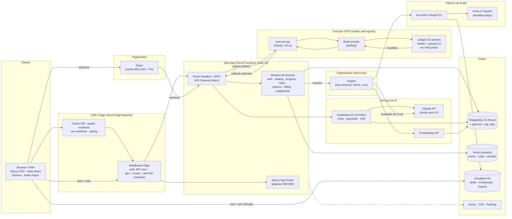
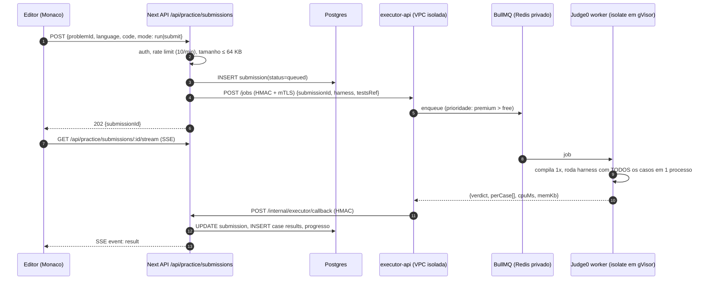
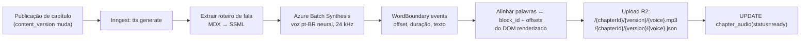
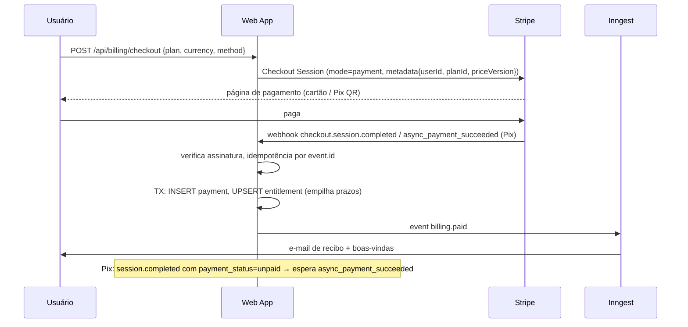

# FASE 3 — System Design & Arquitetura de Backend

> Custos em USD, ordem de grandeza para o estágio de lançamento (≈ 20 mil usuários cadastrados, 2 mil pagantes, 1.500 DAU). Preços de terceiros mudam: revalidar antes de contratar. Preços de LLM conferidos na tabela oficial da Anthropic em 2026-10.

---

## 1. Visão geral: monólito modular + 3 serviços isolados

**[DECISÃO A1] — Next.js como monólito modular (BFF + domínio) e apenas 3 serviços separados: Executor de código, Workers de IA/Conteúdo e Pagamentos via webhooks.**
Os serviços separados existem porque têm **perfil de risco ou de carga** diferente: o executor roda código hostil (isolamento de rede/kernel), os workers fazem jobs longos (TTS, embeddings, avaliação de mock), e webhooks precisam de retry durável. Todo o resto (catálogo, progresso, notas, auth, billing) é CRUD com baixa carga e vive em módulos do monólito (`src/server/modules/*`), com fronteiras explícitas para extração futura.
*Alternativa descartada:* microsserviços por domínio (catalog-svc, progress-svc, notes-svc…) — para uma equipe de 2–5 pessoas isso multiplica deploys, contratos de rede, consistência distribuída e custo fixo, sem ganho de escala real (o gargalo nunca será CRUD de progresso).

### 1.1 Diagrama de arquitetura



---

## 2. Tabela comparativa de stack (camada por camada)

| Camada | Escolha | Alternativa descartada | Por quê | Custo/mês estimado |
|---|---|---|---|---|
| Framework web | **Next.js 15 (App Router) + React 19 + TS** | Remix/React Router 7; Astro | ISR com `revalidateTag`, RSC reduz JS de páginas de leitura; ecossistema | — |
| Hospedagem web | **Vercel Pro** | AWS (OpenNext) / Cloudflare (OpenNext) | ISR/edge nativos, previews por PR. Saída planejada para OpenNext/AWS se custo de funções explodir | $20/membro + uso (~$60–150) |
| ORM | **Drizzle ORM** | Prisma | SQL explícito (CTEs, `FOR UPDATE`, pgvector, índices parciais), sem engine binária, cold start menor em serverless | — |
| Banco | **PostgreSQL 16 gerenciado (Neon)** com `pgvector`, `pg_trgm`, `unaccent` | Supabase; RDS; MongoDB | Branching por PR, autoscale-to-zero em preview, Postgres puro (portável) | $19–69 |
| Cache / cotas / rate limit | **Upstash Redis** (HTTP, serverless) | ElastiCache; Vercel KV | Funciona do Edge, cobrança por requisição, `@upstash/ratelimit` | $10–30 |
| Busca | **Postgres FTS** (`portuguese` + `unaccent`) + `pg_trgm` | Meilisearch / Typesense / Algolia | ~2 mil capítulos + ~1 mil problemas cabem em Postgres; zero infra extra. Migrar para Typesense se > 100k docs | $0 |
| Auth | **Better Auth** (sessões no nosso Postgres) | Auth.js; Clerk | Controle total de sessões por dispositivo (requisito anti-compartilhamento), magic link, OAuth, sem custo por MAU | $0 |
| Jobs duráveis | **Inngest** | BullMQ self-host; Temporal | Funções em steps com retry/idempotência rodando nas próprias Vercel Functions; cron; fan-out | $0–75 |
| Executor de código | **Judge0 CE self-hosted** atrás de `executor-api` próprio | Piston; Judge0 via RapidAPI; AWS Lambda por linguagem | Ver §3 | 2× VM 8 vCPU (~$80–160 Hetzner/~$300 AWS) |
| LLM | **Claude API — `claude-opus-5-5`** ($4 entrada / $20 saída por MTok, leitura de cache $0.20) | Modelos open-source self-hosted | Qualidade em explicação de código e avaliação de entrevista; prompt caching barateia contexto de capítulo | variável (§4.6) |
| Embeddings | API de embeddings multilíngue (ex.: Voyage) → `pgvector` | Pinecone/Weaviate | Vetores ao lado dos dados relacionais (joins com acesso premium); < 200k chunks | ~$5 |
| TTS | **Azure AI Speech** (vozes neurais pt-BR e en-US, eventos `WordBoundary`) | ElevenLabs; Google TTS; OpenAI TTS | Timestamps por palavra nativos (sem alinhamento forçado), SSML, Batch Synthesis | ~US$15–16 por 1M caracteres (geração única por versão) |
| Object storage / CDN de mídia | **Cloudflare R2** + domínio `media.` | S3 + CloudFront | Egress gratuito — áudio é o maior consumidor de banda | $5–20 |
| Pagamentos | **Stripe** (Checkout `mode=payment`, cartão BRL/USD, Pix) atrás de interface `PaymentProvider` | Mercado Pago; Pagar.me | Um provedor para BRL e USD, webhooks maduros, Pix em contas BR. *Verificar Pix habilitado na conta; adapter Mercado Pago como plano B* | 3,99% + R$0,39 cartão BR; Pix ~1,19% (conferir tabela vigente) |
| E-mail | **Resend** + React Email | SES | DX, templates em React | $0–20 |
| Observabilidade | **Sentry** (erros + performance), **OpenTelemetry** → Grafana Cloud, **PostHog** (produto, região UE) | Datadog | Custo; PostHog com feature flags e funis | $0–80 |
| Conteúdo | **MDX em repositório Git** (`content/`) + pipeline CI | CMS headless (Sanity/Payload) | Autores técnicos versionam como código, review por PR, diffs claros; CMS pode vir depois para não-devs | $0 |

**Custo fixo estimado do lançamento: ~US$ 400–900/mês** + IA variável + taxas de pagamento.

---

## 3. Editor & Execução de Código em Sandbox

### 3.1 Requisitos
- Linguagens MVP: Python 3.12, Java 21, JavaScript (Node 22), TypeScript 5, C++20 (g++ 13), Go 1.23.
- "Run" (testes públicos, resposta < 3 s p95) e "Submit" (públicos + ocultos, < 6 s p95).
- Código do usuário é **hostil por definição**: fork bomb, loop infinito, leitura de `/proc`, tentativa de rede, saída gigante, exploração de kernel.

### 3.2 Arquitetura



**[DECISÃO E1] — Judge0 CE self-hosted em VPC isolada, encapsulado por um `executor-api` nosso.**
Judge0 usa `isolate` (o sandbox do IOI) com cgroups v2, namespaces e limites por execução, e já suporta 60+ linguagens. O `executor-api` encapsula: casos ocultos (nunca saem da VPC no payload de resposta ao cliente), harness por linguagem, fila com prioridade, e normalização de veredito.
*Alternativas descartadas:* **Piston** — isolamento por usuário Unix + cgroups menos granular e sem histórico de uso em juízes competitivos; **Judge0 hospedado (RapidAPI)** — envia casos ocultos a terceiros, custo por chamada e sem controle de latência; **Lambda/Cloud Run por linguagem** — cold starts de JVM e sem limite fino de memória por caso.

**[DECISÃO E2] — Um processo por submissão com harness que itera todos os casos (não 1 execução por caso).**
Compilar Java/C++ uma vez e rodar 50 casos no mesmo processo reduz o custo de 50× compilação/arranque de JVM para 1×. O harness (gerado por linguagem a partir da assinatura do problema) desserializa entradas JSON, chama a função do usuário com timeout por caso e emite um JSON de resultados por `stdout` delimitado por um nonce aleatório (o código do usuário não consegue forjar o delimitador).
*Alternativa descartada:* uma submissão Judge0 por caso de teste (padrão do Judge0) — 10–50× mais lento para linguagens compiladas.

### 3.3 Limites rígidos (por submissão)

| Recurso | Run | Submit | Mecanismo |
|---|---|---|---|
| CPU time total | 3 s | 8 s | `isolate --time` (cgroup cpu) |
| CPU por caso (no harness) | 1 s × fator da linguagem (Java/Python 2×) | idem | timer no harness + kill |
| Wall clock | 6 s | 15 s | `--wall-time` |
| Memória | 256 MB (Java: 512 MB heap+metaspace) | idem | `--cg-mem`, `-Xmx` |
| Processos/threads | 64 | 64 | `--processes` (bloqueia fork bomb) |
| Arquivo gravado | 1 MB | 1 MB | `--fsize` |
| stdout + stderr | 64 KB (trunca) | 64 KB | limite do worker |
| Código-fonte | 64 KB | 64 KB | validação na API (Zod) |
| Rede | **desativada** | **desativada** | `isolate` sem net namespace + VM sem rota de saída (SG/egress deny-all) |
| Sistema de arquivos | read-only exceto `/box` tmpfs | idem | `isolate` + imagem imutável |
| Syscalls | gVisor (`runsc`) como runtime do container | idem | kernel de usuário: escape de kernel exige escapar do gVisor *e* do isolate |

### 3.4 Defesa em profundidade do executor
1. **Rede:** VPC dedicada; security group de entrada apenas do IP de saída da Vercel (ou túnel Cloudflare) com **mTLS**; **zero egress** (nem DNS).
2. **Host:** VMs efêmeras recriadas diariamente (imagem imutável Packer); nenhum segredo de produção na VM (o executor nem sabe a URL do banco).
3. **Autenticidade:** requisições e callbacks assinados com HMAC-SHA256 + timestamp (janela 60 s, anti-replay por `jobId`).
4. **Casos ocultos:** armazenados criptografados no Postgres; enviados ao executor por referência (`testsRef` + versão), cacheados no Redis privado; resposta ao cliente mostra só "caso oculto #k falhou" (+ entrada apenas se `revealOnFail=true`).
5. **Abuso:** rate limit por usuário (free 10 runs/min, 200/dia; premium 30/min, 2.000/dia); fila com prioridade e backpressure (HTTP 429 com `Retry-After` quando a fila > N).
6. **Capacidade:** 2 VMs × 8 vCPU, 8 workers cada = 16 execuções simultâneas ≈ 8–10 submissões/s para Python. Autoscaling horizontal por profundidade de fila.

---

## 4. Tutor de IA integrado

### 4.1 Capacidades
- **Ask AI no capítulo:** explicar trecho selecionado, resumir, "me dê uma dica sem a resposta", gerar mini-quiz.
- **No problema:** dica progressiva (nível 1–3), revisar o código do usuário, explicar falha de um caso de teste.
- **Mock interview:** entrevistador (coding / system design / LLD / behavioral) com rubrica e relatório final.

### 4.2 Recuperação de contexto

**[DECISÃO AI1] — O capítulo atual vai inteiro no prompt (com prompt caching); RAG vetorial só para contexto *entre* capítulos.**
O usuário pergunta majoritariamente sobre a página aberta. Capítulos têm 2k–15k tokens: colocá-los inteiros no bloco de sistema, marcado com `cache_control`, dá respostas mais fiéis que recuperar chunks, e a leitura do cache custa 5% do preço de entrada. A busca vetorial (`pgvector`, chunks de ~500 tokens por seção H2/H3, filtrados por `course_id` e por acesso) traz até 4 trechos de **outros** capítulos relacionados.
*Alternativa descartada:* RAG puro top-k em cima do capítulo atual — perde contexto entre seções (ex.: código definido no início e usado no fim) e exige tuning de chunking.

Ordem do prompt (prefixo estável primeiro, para o cache funcionar):

```
[system 1 — estável global, cache 1h]  persona do tutor, regras pedagógicas, política de segurança
[system 2 — estável por capítulo, cache] <chapter id=… version=…> texto plano do capítulo </chapter>
[messages]  histórico da conversa (≤ 20 turnos, compactado)
            → <retrieved_context> trechos de outros capítulos </retrieved_context>  (no turno atual)
            → <user_selection> texto selecionado </user_selection>
            → pergunta do usuário
```

**[DECISÃO AI2] — Acesso premium é aplicado na recuperação, não no prompt.** Um usuário free nunca recebe chunks de capítulos premium em `<retrieved_context>` (filtro SQL `WHERE access='free' OR :isPremium`) e o tutor em capítulo premium só abre para quem tem acesso. *Alternativa descartada:* instruir o modelo a "não revelar conteúdo premium" — instrução não é controle de acesso.

### 4.3 Streaming via SSE

```ts
// src/app/api/ai/tutor/route.ts (resumo)
import Anthropic from "@anthropic-ai/sdk";
const client = new Anthropic();

export async function POST(req: Request) {
  const user = await requireUser(req);
  const input = TutorRequest.parse(await req.json());            // Zod
  await assertQuota(user, "tutor");                               // 429 se estourou
  const ctx = await buildTutorContext(user, input);               // capítulo + RAG filtrado

  const stream = client.messages.stream({
    model: "claude-opus-5-5",
    max_tokens: 4000,
    output_config: { effort: "low" },                             // chat de tutor: low; revisão de código: medium
    system: [
      { type: "text", text: TUTOR_SYSTEM_PROMPT, cache_control: { type: "ephemeral", ttl: "1h" } },
      { type: "text", text: ctx.chapterBlock, cache_control: { type: "ephemeral" } },
    ],
    messages: ctx.messages,
  });

  const body = new ReadableStream({
    async start(controller) {
      const send = (event: string, data: unknown) =>
        controller.enqueue(new TextEncoder().encode(`event: ${event}\ndata: ${JSON.stringify(data)}\n\n`));
      stream.on("text", (delta) => send("delta", { t: delta }));
      try {
        const final = await stream.finalMessage();
        if (final.stop_reason === "refusal") send("refusal", {});
        await recordUsage(user.id, "tutor", final.usage);         // tokens → cota e custo
        send("done", { usage: final.usage });
      } catch (err) {
        send("error", { code: "AI_UNAVAILABLE" });
      } finally {
        controller.close();
      }
    },
    cancel() { stream.abort(); },                                  // usuário fechou o painel → para de gastar
  });

  return new Response(body, {
    headers: { "Content-Type": "text/event-stream", "Cache-Control": "no-store", "X-Accel-Buffering": "no" },
  });
}
```

Notas de implementação:
- Função Node (não Edge) com `maxDuration = 60`; SSE atravessa a CDN sem buffering.
- Opcional e recomendado: habilitar o parâmetro de fallback do servidor (`fallbacks: "default"` com o beta `server-side-fallback-2026-07-01`, via `client.beta.messages.stream`) para que uma recusa do classificador de segurança seja reexecutada automaticamente em outro modelo, em vez de devolver erro ao aluno. Tratar `stop_reason === "refusal"` mesmo assim.
- O cliente reconecta com `Last-Event-ID`; respostas completas ficam em `ai_messages` para retomar o histórico.

### 4.4 Controle de custos e cotas por tier

| Tier | Mensagens tutor/dia | Mock interviews/mês | Teto de custo/usuário/mês | Effort |
|---|---|---|---|---|
| Anônimo | 0 (CTA de cadastro) | 0 | — | — |
| Free | 10 | 1 (coding, 30 min) | US$ 0,50 | `low` |
| Premium | 150 (*fair use*) | 20 | US$ 6 | `low` chat · `medium` revisão de código · `high` relatório de mock |

Mecânica:
1. **Pré-checagem** (Redis, `INCR` atômico com TTL até a meia-noite em `America/Sao_Paulo`): contador de mensagens e de custo em micro-dólares.
2. **Pós-contabilização** com `usage` real (`input_tokens`, `cache_read_input_tokens`, `cache_creation_input_tokens`, `output_tokens`) × tabela de preço versionada em `ai_pricing`.
3. **Disjuntor global:** se o gasto do dia > 150% da média de 7 dias, o tier free fica pausado e um alerta dispara.
4. **Limites de entrada:** seleção ≤ 4k caracteres, histórico ≤ 20 turnos (compactação depois disso), código ≤ 64 KB.

### 4.5 Mock interview com IA
- Sessão com estado (`interview_sessions`): fase (`intro → clarificação → solução → complexidade → follow-ups → wrap-up`), timer, editor/whiteboard compartilhado.
- O entrevistador recebe o problema + rubrica (privada) + estado do editor a cada turno; nunca recebe a solução canônica como texto de resposta, só como "referência do avaliador" em bloco separado, com instrução de não revelar.
- Ao final, um job Inngest gera o **relatório estruturado** (saída JSON validada por schema: notas 1–4 em comunicação, resolução, código, testes, complexidade; evidências citando falas; plano de estudo com links de capítulos).

### 4.6 Custo unitário estimado (Opus 5.5)
| Operação | Tokens típicos | Custo |
|---|---|---|
| 1ª pergunta num capítulo (escrita de cache de 8k + 300 entrada + 600 saída) | — | ≈ US$ 0,055 |
| Perguntas seguintes (cache lido 8k + 1k + 600 saída) | — | ≈ US$ 0,018 |
| Mock interview de 45 min (≈ 30 turnos, histórico cacheado) + relatório | — | ≈ US$ 0,60–1,20 |

Premium usando 40 mensagens/dia por 20 dias ≈ US$ 15/mês no extremo; a mediana esperada (8–10 mensagens/dia em dias ativos) fica abaixo de US$ 3. O passe anual (R$ 399 ≈ US$ 70) cobre o custo mediano com folga; o teto de US$ 6/mês protege a margem. Se a margem apertar, as alavancas na ordem são: cache mais longo → effort menor → modelo mais barato para dicas simples (decisão de produto, medir qualidade antes).

---

## 5. Engine de Áudio / TTS com destaque sincronizado

### 5.1 Pipeline (offline, por versão de capítulo)



**Roteiro de fala (script):** o extrator percorre a AST do MDX:
- Parágrafos/listas/headings → texto falado; cada palavra mantém `block_id` + `charStart`/`charEnd` do texto **renderizado**.
- Blocos de código → **não lidos literalmente**. Usam uma narração curta escrita pelo autor (`<Code narration="...">`) ou, na falta dela, uma narração gerada uma vez por IA no pipeline e revisada pelo autor. O destaque nesse trecho é por **linha de código** (`lineRange`).
- Diagramas → narração do `alt`/`<Figure narration>`.
- Fórmulas Big-O → normalizadas via SSML (`O(n log n)` → "ó de n log n").

**Formato dos timestamps (`.json`, servido gzip/br):**

```ts
type AudioAlignment = {
  v: 1;
  chapterId: string;
  contentVersion: string;     // tem que bater com o MDX renderizado
  voice: "pt-BR-FranciscaNeural" | "pt-BR-AntonioNeural" | "en-US-AvaNeural";
  durationMs: number;
  blocks: Array<{
    blockId: string;          // data-block-id no DOM
    startMs: number;
    endMs: number;
    kind: "text" | "code" | "figure";
    // text: palavras; code: linhas
    words?: Array<[startMs: number, endMs: number, charStart: number, charEnd: number]>;
    lines?: Array<[startMs: number, endMs: number, lineFrom: number, lineTo: number]>;
  }>;
};
```
Tuplas em vez de objetos: um capítulo de 3.000 palavras ≈ 90 KB JSON → ~20 KB br.

### 5.2 Sincronização no cliente
- `<audio>` nativo com `preload="metadata"`; o mp3 é servido pelo R2 com suporte a `Range` (seek instantâneo).
- Loop `requestAnimationFrame` lê `audio.currentTime`, faz **busca binária** no array de blocos e depois no de palavras (O(log n), sem varrer o DOM).
- Destaque com a **CSS Custom Highlight API** (`CSS.highlights.set('tts-word', new Highlight(range))`): não modifica o DOM, não conflita com os `<mark>` de highlights do usuário e não causa reflow. Fallback para navegadores sem suporte: só o bloco recebe `data-tts-block="active"`.
- Auto-scroll: `scrollIntoView({block:"center"})` apenas quando o bloco ativo sai de uma "zona de conforto" (20%–70% da viewport) e pausa por 4 s se o usuário rolar manualmente.
- Clicar em um parágrafo → `audio.currentTime = block.startMs/1000` ("ouvir a partir daqui").
- Velocidade 0,75×–2× (`playbackRate`, `preservesPitch`), Media Session API (controles na tela de bloqueio), continua na troca de capítulo (auto-advance opcional).

**[DECISÃO TTS1] — Geração prévia por versão + CDN, nunca TTS em tempo real.** Custo de geração único: ~10M caracteres no catálogo × ~US$ 15–16/M ≈ **US$ 160 por voz**, mais regeneração só do que mudou. Latência zero, seek preciso, cache perfeito. *Alternativa descartada:* TTS por streaming sob demanda — custo por play (proibitivo com milhares de reproduções), sem seek e com timestamps aproximados.

**[DECISÃO TTS2] — Timestamps nativos do provedor (WordBoundary) em vez de alinhamento forçado.** *Alternativa descartada:* gerar áudio em qualquer provedor e alinhar com WhisperX/Montreal Forced Aligner — mais uma etapa de ML para operar e erros de alinhamento em termos técnicos ("HashMap", "O(n)").

**Gating:** o `.json` e o `.mp3` têm URLs assinadas de curta duração (R2 presigned, 2 h) emitidas por `GET /api/content/chapters/:id/audio` após checar o direito de acesso. O áudio é premium; a 1ª seção de capítulos free fica aberta como amostra.

---

## 6. Pagamentos e direitos de acesso

**Modelo:** passes de pagamento único (Mensal 30 dias, Anual 365 dias, Vitalício). Sem renovação automática.



**Regras de direito de acesso:**
- `access_expires_at = max(now, access_expires_at_atual) + duração` → comprar um Mensal com o Anual ativo **soma** o tempo, não substitui.
- Vitalício: `access_expires_at = NULL` + `is_lifetime = true`.
- Reembolso/chargeback (`charge.refunded`, `charge.dispute.created`) → recalcula a partir da soma dos pagamentos válidos.
- Verificação no request: claim `ent` (expiração) dentro do JWT de sessão (TTL 15 min) + Redis; a fonte de verdade é o Postgres.
- Avisos: e-mails em D-14, D-3 e D-0; banner no app em D-7.

**[DECISÃO P1] — Direito derivado de pagamentos (ledger), não um campo "plano" editável.** O direito é recalculável a partir de `payments` + `entitlement_grants` (inclui concessões manuais e cupons), o que torna estornos e auditorias triviais. *Alternativa descartada:* campo `users.plan` alterado pelo webhook — perde histórico e quebra com eventos fora de ordem.

---

## 7. Requisitos não funcionais

| Requisito | Meta |
|---|---|
| Disponibilidade (leitura de conteúdo) | 99,9% (servida pela CDN mesmo com o banco fora do ar) |
| Disponibilidade (app autenticado) | 99,5% |
| p95 API de progresso/notas | < 150 ms |
| p95 Run (Python) | < 3 s |
| Primeiro token do tutor | < 2 s p75 |
| RPO / RTO | 5 min (PITR do Neon) / 1 h |
| Retenção de logs | 30 dias (sem conteúdo de código/notas, só metadados) |
| Região de dados | `sa-east-1` (São Paulo) para Postgres, `aws-sa-east-1`/GRU para funções Vercel (proximidade com usuários BR) |

---

**Fim da Fase 3.**
