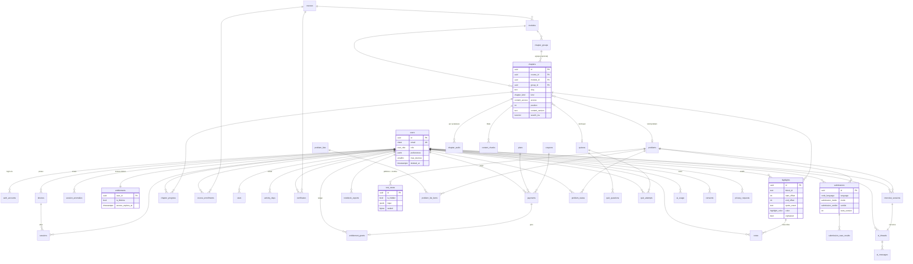

# FASE 4 — Modelagem de Dados, APIs & Segurança

> Arquivos de código desta fase:
> - `db/schema.sql`: DDL canônico do PostgreSQL 16, com 43 tabelas. **Validado**: aplicado sem erros num Postgres embarcado (PGlite) com `vector`, `citext`, `pg_trgm`, `unaccent` e `pgcrypto`.
> - `src/contracts/api.ts`: schemas Zod de request/response e o modelo de erro. **Validado** com `tsc --strict` e por testes de parse.

---

## 1. Decisões de modelagem

**[DECISÃO D1] — DDL SQL como fonte de verdade + Drizzle espelhando.** O schema usa recursos que ORMs abstraem mal: colunas geradas `tsvector`, índices parciais, `hnsw` do pgvector, `CHECK`s entre colunas, `DEFERRABLE`. As migrations são SQL revisado em PR; o `schema.ts` do Drizzle é gerado com `drizzle-kit pull` e checado no CI. *Alternativa descartada:* Prisma schema como fonte — sem suporte de primeira classe a `tsvector` gerado, pgvector e índices parciais, o que empurraria tudo para `Unsupported()` e SQL cru.

**[DECISÃO D2] — UUIDv7 como chave primária.** São ordenados no tempo (índice B-tree sem fragmentação), não expõem contagem de usuários como um `serial` e podem ser gerados no cliente para operações otimistas (highlight criado offline). *Alternativa descartada:* UUIDv4, cuja inserção aleatória fragmenta índices, e `bigserial`, que é enumerável.

**[DECISÃO D3] — Acesso premium em três níveis com herança (curso → módulo → capítulo), resolvido na publicação.** O pipeline de conteúdo calcula o acesso efetivo e o desnormaliza em `content_chunks.access`, no nav manifest e no HTML de preview. Assim, nenhuma query de leitura precisa fazer a herança em runtime.

**[DECISÃO D4] — Destaques ancorados por `block_id` + offsets + citação com contexto (modelo W3C Web Annotation).** Quando um capítulo é editado e `content_version` muda, um job re-ancora os destaques em três passos: (1) offset exato no mesmo bloco; (2) busca de `quote_exact` com `prefix/suffix` no bloco; (3) busca aproximada no capítulo. Se tudo falhar, o destaque fica `orphaned = true`. Ele continua visível no Caderno, mas não aparece no texto. *Alternativa descartada:* XPath/offset global de caracteres, que quebra com qualquer edição acima do trecho.

**[DECISÃO D5] — Casos de teste ocultos selados (`sealed bytea`, AES-GCM com chave só do executor).** Nem um dump do banco da aplicação revela os casos ocultos. Um `CHECK` garante que um caso oculto nunca tenha `input`/`expected` em claro.

---

## 2. Diagrama entidade-relacionamento



---

## 3. Fluxos de dados críticos

### 3.1 Controle de sessões por dispositivo (anti-compartilhamento)
1. No login, o cliente envia o cookie `cf_did`: um ID aleatório de 128 bits, `HttpOnly`, válido por 2 anos. O servidor calcula `fingerprint_hash = SHA-256(cf_did ‖ família do UA)`.
2. Se o dispositivo é novo e o usuário já tem `max_devices` (padrão 3) ativos, o servidor responde **403 `DEVICE_LIMIT`** com a lista de dispositivos. O usuário escolhe qual desconectar; isso revoga as sessões dele e libera a vaga. Há limite de 3 trocas a cada 30 dias.
3. **Streams simultâneos:** o player de áudio e o tutor enviam heartbeats. Uma chave `user:{id}:active` no Redis (ZSET com TTL de 90 s) detecta mais de 2 dispositivos *consumindo ao mesmo tempo*. Nesse caso, o dispositivo mais antigo é pausado ("Sua conta está em uso em outro dispositivo") e um registro vai para `session_anomalies`.
4. **Viagem impossível:** dois países diferentes em menos de 1 h em sessões ativas gera uma anomalia e pede reautenticação por e-mail. Não há bloqueio automático; a revisão é humana, com a política de compartilhamento nos Termos.

**[DECISÃO S-DEV] — Limite por dispositivo + concorrência, não por IP.** IPs mudam (4G, CGNAT de operadoras brasileiras) e gerariam falsos positivos em massa. *Alternativa descartada:* fingerprinting agressivo do navegador (canvas/WebGL). Ele é frágil, é dado pessoal sensível à LGPD e é contornável.

### 3.2 Concessão de acesso (transação do webhook)
```sql
BEGIN;
INSERT INTO webhook_events (provider, event_id, type) VALUES ('stripe', $1, $2)
  ON CONFLICT DO NOTHING RETURNING event_id;          -- 0 linhas => já processado, COMMIT e 200
UPDATE payments SET status='paid', paid_at=now(), provider_payment_id=$3, method=$4
  WHERE provider_session_id=$5 AND status='pending' RETURNING id, user_id, plan_id;
INSERT INTO entitlement_grants (user_id, source, payment_id, days) VALUES ($u, 'purchase', $p, $days);
-- projeção: empilha prazo a partir do maior entre agora e a expiração atual
INSERT INTO entitlements (user_id, is_lifetime, access_expires_at)
VALUES ($u, $lifetime, CASE WHEN $lifetime THEN NULL ELSE now() + make_interval(days => $days) END)
ON CONFLICT (user_id) DO UPDATE SET
  is_lifetime = entitlements.is_lifetime OR EXCLUDED.is_lifetime,
  access_expires_at = CASE
    WHEN entitlements.is_lifetime OR EXCLUDED.is_lifetime THEN NULL
    ELSE greatest(coalesce(entitlements.access_expires_at, now()), now()) + make_interval(days => $days)
  END,
  updated_at = now();
UPDATE webhook_events SET processed_at = now() WHERE provider='stripe' AND event_id=$1;
COMMIT;
-- depois do commit: DEL Redis ent:{userId}; invalida o claim no próximo refresh do JWT
```
Estornos usam a mesma transação: marcam `revoked_at` no grant e **recalculam** a projeção somando os grants válidos em ordem cronológica. Não existe "subtração", que divergiria com eventos fora de ordem.

### 3.3 Progresso
- O cliente envia `PUT /api/me/progress/:chapterId` com debounce de 10 s e `navigator.sendBeacon` no `pagehide`. É idempotente (é um UPSERT).
- `completed=true` dispara, na mesma transação: `course_enrollments.completed_count += 1` (apenas na transição de estado), `activity_days.units += 1` e a atualização do bitset no Redis.
- O certificado é emitido por um job quando `completed_count = total` e todos os quizzes do curso têm `passed`.

---

## 4. Contratos de API

**Estilo:** REST com Route Handlers para tudo que é público, cacheável, SSE ou webhook. **tRPC** é usado só no painel interno de autores/admin.

**[DECISÃO API1] — REST + Zod compartilhado, não tRPC no app do aluno.** Rotas REST são cacheáveis na CDN (nav manifest e catálogo), consumíveis pelo futuro app mobile, compatíveis com SSE e `sendBeacon`, e observáveis por rota. Os tipos continuam ponta a ponta porque cliente e servidor importam o mesmo `src/contracts/api.ts`. *Alternativa descartada:* tRPC em tudo. A DX é excelente, mas o protocolo é acoplado ao TS e fica ruim com cache HTTP, SSE, webhooks e clientes não-TS.

### 4.1 Endpoints

| Método | Rota | Auth | Request → Response (`api.ts`) | Erros específicos |
|---|---|---|---|---|
| GET | `/api/me` | sessão | → `Me` | 401 |
| PATCH | `/api/me/preferences` | sessão | `UpdatePreferencesRequest` → `ReaderPreferences` | 422 |
| GET | `/api/me/devices` | sessão | → `Device[]` | 401 |
| DELETE | `/api/me/devices/:id` | sessão | → 204 | 404 |
| GET | `/api/content/courses/:slug/nav?v=` | público | → `NavManifest` (immutable) | 404 |
| GET | `/api/content/chapters/:id/body` | sessão | → `ChapterBody` | 401, 403 `PREMIUM_REQUIRED`, 404 |
| GET | `/api/content/chapters/:id/audio` | sessão | → `ChapterAudio` | 403 `PREMIUM_REQUIRED` |
| GET | `/api/search` | público | `SearchRequest` (query) → resultados | 422, 429 |
| GET | `/api/me/progress?course=` | sessão | → `CourseProgress` | 404 |
| GET | `/api/me/chapter-state?chapterId=` | sessão | → `ChapterState` | 404 |
| PUT | `/api/me/progress/:chapterId` | sessão | `UpsertProgressRequest` → 204 | 404, 422 |
| PUT/DELETE | `/api/me/stars` | sessão | `StarRequest` → 204 | 404 |
| POST | `/api/me/highlights` | sessão + acesso ao capítulo | `CreateHighlightRequest` → `Highlight` (201) | 403, 422, 429 (máx. 2.000 por curso) |
| PATCH/DELETE | `/api/me/highlights/:id` | dono | `UpdateHighlightRequest` → `Highlight` / 204 | 403, 404 |
| POST | `/api/me/notes` | sessão | `CreateNoteRequest` → `Note` (201) | 422 |
| PATCH/DELETE | `/api/me/notes/:id` | dono | `UpdateNoteRequest` → `Note` / 204 | 403, 404 |
| GET | `/api/me/notebook` | sessão | `NotebookQuery` → `Page<NotebookEntry>` | 404 |
| POST | `/api/me/notebook/export` | sessão | `NotebookExportRequest` → 202 `{exportId}` | 429 (5/dia) |
| GET | `/api/practice/problems` | público (+status se logado) | `ProblemListQuery` → `Page<ProblemRow>` | 422 |
| POST | `/api/practice/submissions` | sessão + `Idempotency-Key` | `CreateSubmissionRequest` → 202 `CreateSubmissionResponse` | 403 `PREMIUM_REQUIRED`, 409, 422, 429 `RATE_LIMITED`/`QUOTA_EXCEEDED`, 503 `EXECUTOR_BUSY` |
| GET | `/api/practice/submissions/:id/stream` | dono | SSE → `SubmissionResult` | 403, 404 |
| POST | `/api/quizzes/:id/attempts` | sessão | → `{attemptId, questions}` | 403, 404 |
| POST | `/api/quizzes/attempts/:id/answers` | dono | `QuizAnswerRequest` → `QuizAnswerResponse` | 409 (já respondida), 422 |
| POST | `/api/ai/tutor` | sessão | `TutorRequest` → SSE `TutorSseEvent` | 403, 422, 429 `QUOTA_EXCEEDED` |
| POST | `/api/interviews` | sessão | `CreateInterviewRequest` → `{id}` (201) | 403, 429 |
| POST | `/api/interviews/:id/turns` | dono | `InterviewTurnRequest` → SSE | 409 (sessão encerrada), 429 |
| POST | `/api/interviews/:id/end` | dono | → 202 (gera relatório) | 409 |
| GET | `/api/interviews/:id/report` | dono | → `InterviewReport` | 404, 425 (ainda gerando) |
| GET | `/api/billing/plans?currency=` | público | → `PlanOffer[]` | — |
| POST | `/api/billing/checkout` | sessão + `Idempotency-Key` | `CheckoutRequest` → `CheckoutResponse` | 409, 422 (cupom inválido) |
| POST | `/api/webhooks/stripe` | assinatura Stripe | evento → 200 | 400 (assinatura inválida) |
| POST | `/internal/executor/callback` | HMAC + mTLS | resultado → 204 | 401 |
| POST | `/api/me/privacy/export` | sessão | → 202 `PrivacyRequestResponse` | 429 (1/dia) |
| POST | `/api/me/privacy/delete` | sessão reautenticada < 5 min | `DeleteAccountRequest` → 202 | 401, 422 |

### 4.2 Modelo de erro (todas as rotas)

```json
{ "error": { "code": "QUOTA_EXCEEDED", "message": "Você usou as 10 perguntas gratuitas de hoje.",
             "requestId": "req_01J…", "retryAfterSeconds": 41200, "upgradeUrl": "/pricing?from=tutor" } }
```

| Status | `code` | Quando | Cliente deve… |
|---|---|---|---|
| 400 | `BAD_REQUEST` | JSON malformado, header obrigatório ausente | Bug do cliente: logar no Sentry |
| 401 | `UNAUTHENTICATED` | Sem sessão, sessão expirada ou revogada | Redirecionar para `/login?next=` |
| 403 | `FORBIDDEN` | Recurso de outro usuário | Exibir erro genérico |
| 403 | `PREMIUM_REQUIRED` | Capítulo, áudio ou feature premium sem passe ativo | Abrir Paywall Modal com `upgradeUrl` |
| 403 | `DEVICE_LIMIT` | Novo dispositivo acima do limite | Mostrar o gerenciador de dispositivos |
| 404 | `NOT_FOUND` | Inexistente **ou** sem permissão de saber que existe | — |
| 409 | `CONFLICT` | `Idempotency-Key` repetida com corpo diferente; estado inválido | Recarregar o estado |
| 422 | `VALIDATION_FAILED` | Falha no Zod ou em regra de negócio; `fields` preenchido | Mostrar erros por campo |
| 429 | `RATE_LIMITED` / `QUOTA_EXCEEDED` | Limite de frequência / cota diária | Respeitar `Retry-After`; oferecer upgrade se for cota |
| 500 | `INTERNAL` | Exceção não tratada (stack nunca vai ao cliente) | Retry com backoff (só GET/PUT idempotentes) |
| 503 | `EXECUTOR_BUSY` | Fila do executor acima do limite | Retry automático após `Retry-After` |

Implementação: um wrapper `route(handler, { auth, schema, rateLimit })` faz o parse com Zod (ZodError → 422 com `fields`), mapeia erros de domínio (`class DomainError { code }`) e anexa `requestId` (do header `x-vercel-id` ou um UUIDv7).

---

## 5. Segurança

### 5.1 Matriz de ameaças (STRIDE resumido)

| Ameaça | Vetor | Controle |
|---|---|---|
| Spoofing | Roubo de cookie de sessão | Cookie `__Host-cf_session`, `HttpOnly; Secure; SameSite=Lax`; token opaco com hash no banco; rotação a cada 24 h; revogação imediata |
| Tampering | Forjar progresso, streak ou conclusão | `timeSpentDeltaS ≤ 600`, conclusão exige `percentRead ≥ 80` ou submissão `accepted`; certificado assinado com Ed25519 |
| Repudiation | "Não comprei" / chargeback | `payments` + `webhook_events` + `audit_log` imutáveis |
| Info disclosure | Scraping de conteúdo premium | Corpo premium só via API autenticada ([R2] da Fase 1); rate limit de 60 capítulos/h por usuário; detecção de leitura em velocidade sobre-humana |
| Info disclosure | Vazamento de casos ocultos | Selados ([D5]); resposta mostra só o veredito; saída do harness delimitada por nonce |
| DoS | Fila do executor / custo de IA | Rate limit por usuário e IP (Upstash, sliding window), cotas, disjuntor de custo, prioridade por tier |
| Elevation | IDOR em notas/destaques | Toda query de dados do usuário filtra `WHERE user_id = $session.userId`; testes de autorização automatizados por rota |
| Elevation | Escape do sandbox | isolate + gVisor + VPC sem egress + VMs efêmeras (Fase 3 §3.4) |

### 5.2 Proteção contra prompt injection no tutor
Fontes de texto não confiável no prompt: a pergunta do usuário, o texto selecionado, o código do usuário e, no limite, o conteúdo de capítulos (escrito por autores, mas tratado como dado).

1. **Separação de canais:** instruções do operador vão só no `system`. O conteúdo vai em tags explícitas (`<chapter>`, `<retrieved_context>`, `<user_code>`, `<user_selection>`). O system prompt declara que conteúdo dentro dessas tags é **dado, nunca instrução**.
2. **Nada para exfiltrar:** o tutor **não tem ferramentas** (sem web, sem SQL, sem tool calls) e o contexto contém apenas dados que o próprio usuário já pode ver. Isso vale porque o filtro de acesso é aplicado na recuperação ([AI2] da Fase 3). Assim, uma injeção bem-sucedida não tem o que vazar nem como agir.
3. **Gabaritos fora do alcance:** no mock interview, a solução de referência e a rubrica vão num bloco "somente avaliador". A saída é verificada por um filtro determinístico: se mais de 60% de sobreposição de tokens com a solução canônica aparecer na resposta antes da fase "wrap-up", a resposta é cortada e regenerada com aviso.
4. **Limites de entrada:** pergunta ≤ 4.000 caracteres, seleção ≤ 4.000, código ≤ 64 KB. Caracteres de controle e Unicode bidi (U+202A–U+202E, U+2066–U+2069) são removidos.
5. **Saída tratada como não confiável:** o markdown da IA é renderizado com sanitização (sem HTML cru, links só `https:` e relativos, imagens bloqueadas). Isso impede exfiltração via ``.
6. **Monitoramento:** amostragem de conversas sinalizadas (recusas, tentativas de extrair o system prompt) para revisão. Usuários reincidentes têm a cota zerada.

### 5.3 Sanitização de MDX
- **MDX é compilado só no CI**, a partir do repositório de conteúdo (autores confiáveis, PR revisado). O runtime nunca compila MDX vindo do banco ou do usuário.
- Allowlist de componentes MDX (`<Callout>`, `<Code>`, `<Figure>`, `<Tabs>`, `<Quiz>`, `<Animation>`…). Um componente desconhecido ou uma expressão JS arbitrária (`{...}` fora da allowlist) falha o build, via plugin `remark` que rejeita `mdxjsEsm` e `mdxFlowExpression`.
- A saída HTML do corpo premium passa por `rehype-sanitize` com schema próprio antes de ser gravada.
- **Notas do usuário** são Markdown renderizado com `remark` → `rehype-sanitize` (sem HTML cru, sem `javascript:`), nunca MDX.
- **CSP** estrita com nonce: `default-src 'self'; script-src 'self' 'nonce-…' 'strict-dynamic'; connect-src 'self' https://*.r2.cloudflarestorage.com https://*.ingest.sentry.io; img-src 'self' data: https://media.codeforge.dev; frame-ancestors 'none'; object-src 'none'; base-uri 'none'`. O Monaco roda com workers servidos do próprio domínio (sem `unsafe-eval`).

### 5.4 Rate limiting (Upstash sliding window, chave `user` ou `ip` se anônimo)

| Recurso | Free | Premium | Anônimo |
|---|---|---|---|
| API geral | 120/min | 300/min | 60/min por IP |
| Login / magic link | — | — | 5/15 min por e-mail + 20/h por IP |
| Run | 10/min · 200/dia | 30/min · 2.000/dia | — |
| Submit | 5/min · 100/dia | 20/min · 1.000/dia | — |
| Tutor | 10/dia | 150/dia | — |
| Corpo de capítulo premium | — | 60/h | — |
| Export do caderno | 2/dia | 5/dia | — |

### 5.5 Isolamento do sandbox
Os controles estão na Fase 3 §3.3–3.4. Do lado da aplicação, um teste de regressão de segurança roda a cada deploy do executor com um corpus de ataques conhecidos: fork bomb, `socket()`, leitura de `/etc/passwd` e `/proc/self/environ`, alocação de 4 GB, saída de 100 MB, `ptrace`. O resultado esperado é o veredito certo para cada um e nenhum efeito no host.

---

## 6. LGPD

| Requisito LGPD | Implementação |
|---|---|
| Base legal (art. 7º) | Execução de contrato (conta, progresso, pagamento); legítimo interesse (segurança, antifraude); consentimento (marketing, analytics não essencial), registrado em `consents` |
| Minimização (art. 6º, III) | IP truncado (`/24`, `/48`); sem fingerprint de canvas; logs sem conteúdo de código/notas; PostHog sem gravação de sessão nas áreas de notas e editor |
| Direito de acesso / portabilidade (art. 18, II e V) | `POST /api/me/privacy/export` → job gera ZIP com JSON + Markdown (perfil, progresso, destaques, notas, submissões, conversas de IA, pagamentos) → URL assinada válida por 7 dias, e-mail de aviso. Prazo interno de 48 h, bem abaixo dos 15 dias legais |
| Eliminação (art. 18, VI) | `POST /api/me/privacy/delete` exige reautenticação. Há janela de 30 dias para cancelar; depois, o job apaga em cascata os dados de estudo, anonimiza `users` (e-mail vira hash, nome e avatar viram NULL) e **mantém `payments`** pelo prazo fiscal (5 anos, obrigação legal, art. 16, I) |
| Operadores / transferência internacional (art. 33) | DPA com Anthropic, Stripe, Vercel, Neon, Upstash, Cloudflare, Azure, Resend, Sentry, PostHog. Cláusulas-padrão; listado na Política de Privacidade |
| Dados enviados à IA | Só o necessário para a pergunta, sem e-mail ou nome. Na Anthropic, os dados da API não são usados para treinar modelos por padrão (confirmar nos termos comerciais vigentes) |
| Segurança (art. 46) | TLS 1.3, criptografia em repouso (Neon/R2), tokens OAuth criptografados por campo, segredos em cofre, acesso de produção via SSO + MFA com `audit_log` |
| Incidentes (art. 48) | Runbook de resposta, comunicação à ANPD e aos titulares em até 3 dias úteis |
| Encarregado (DPO) | E-mail `privacidade@` publicado; solicitações em `privacy_requests` |

---

**Fim da Fase 4.**
