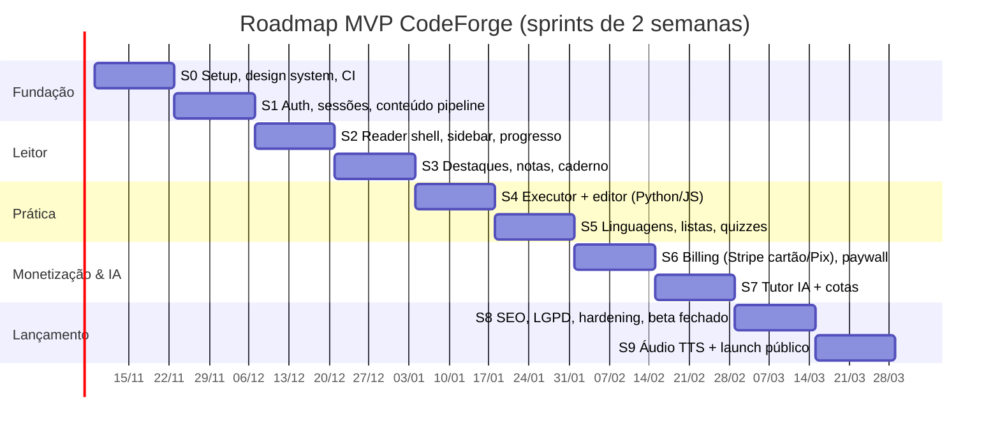

# FASE 5 — Componentização de Frontend, SEO & Roadmap

---

## 1. Árvore de pastas

```
codeforge/
├─ content/                              # repositório de conteúdo (MDX) — Fase 1 [R3]
│  ├─ courses/
│  │  └─ dsa/
│  │     ├─ course.yaml                  # título, módulos, ordem, acesso padrão
│  │     ├─ 01-welcome/
│  │     │  ├─ module.yaml
│  │     │  └─ how-to-use-this-course.mdx
│  │     └─ 08-two-pointers/
│  │        ├─ module.yaml               # grupos + ordem dos capítulos
│  │        ├─ intro-two-pointers.mdx
│  │        └─ move-zeroes.mdx           # kind: problem → problems/move-zeroes
│  ├─ problems/move-zeroes/{problem.yaml,statement.mdx,editorial.mdx,tests.public.json,tests.hidden.json.age}
│  └─ quizzes/two-pointers.yaml
├─ db/
│  ├─ schema.sql                         # Fase 4
│  └─ migrations/0000_init.sql …
├─ design-system/                        # Fase 2
│  ├─ tokens.css · tailwind.config.ts · scripts/contrast.mjs
├─ services/
│  └─ executor-api/                      # Fastify + BullMQ + harness por linguagem (deploy separado)
│     ├─ src/{server.ts,queue.ts,judge0.ts,verdict.ts}
│     └─ harness/{python,java,javascript,typescript,cpp,go}/
├─ scripts/
│  ├─ build-content.ts                   # MDX → AST/HTML/TOC/block_ids/body_plain → Postgres + revalidateTag
│  └─ seed.ts
└─ src/
   ├─ app/
   │  ├─ layout.tsx                      # <html data-theme…>, fontes, providers
   │  ├─ globals.css
   │  ├─ (marketing)/{page.tsx,courses/page.tsx,pricing/page.tsx,faq/page.tsx,legal/[doc]/page.tsx}
   │  ├─ (auth)/{login/page.tsx,signup/page.tsx}
   │  ├─ (learn)/learn/[course]/
   │  │  ├─ layout.tsx                   # ReaderShell persistente (sidebar não remonta entre capítulos)
   │  │  ├─ page.tsx                     # landing do curso
   │  │  ├─ [chapter]/page.tsx           # capítulo (ISR) + ilhas
   │  │  ├─ [chapter]/opengraph-image.tsx
   │  │  └─ notebook/page.tsx
   │  ├─ (practice)/practice/{[track]/page.tsx,[track]/[problem]/page.tsx,lists/[list]/page.tsx}
   │  ├─ (interview)/interview/{[type]/page.tsx,[type]/[sessionId]/page.tsx}
   │  ├─ (app)/{dashboard/page.tsx,settings/[section]/page.tsx,checkout/[plan]/page.tsx,checkout/status/page.tsx}
   │  ├─ certificates/[code]/page.tsx
   │  ├─ api/                            # Route Handlers — Fase 4 §4
   │  │  ├─ og/route.tsx
   │  │  ├─ me/… · content/… · practice/… · ai/tutor/route.ts · interviews/… · billing/… · webhooks/stripe/route.ts
   │  ├─ sitemap.ts · robots.ts · manifest.ts
   │  └─ not-found.tsx · error.tsx · global-error.tsx
   ├─ components/
   │  ├─ ui/                             # primitivos (Radix + tokens): Button, IconButton, Badge, Dialog, Popover,
   │  │                                  # Tooltip, Tabs, Toggle, Slider, Progress, Skeleton, Kbd, Toast
   │  ├─ reader/
   │  │  ├─ ReaderShell.tsx              # grid: sidebar | prose | toc | aside
   │  │  ├─ CourseSidebar/{CourseSidebar.tsx,ModuleSection.tsx,ChapterItem.tsx,useNavManifest.ts,useProgressBitset.ts}
   │  │  ├─ Prose/{Prose.tsx,mdx-components.tsx,Callout.tsx,CodeBlock.tsx,Figure.tsx}
   │  │  ├─ TableOfContents.tsx
   │  │  ├─ ReadingSettings.tsx          # popover "Aa"
   │  │  ├─ ChapterFooterNav.tsx
   │  │  ├─ highlights/{HighlightLayer.tsx,SelectionToolbar.tsx,anchoring.ts}
   │  │  └─ aside/{AsidePanel.tsx,TutorChat.tsx,NotesPanel.tsx}
   │  ├─ audio/{AudioPlayer.tsx,useAlignment.ts,useTtsHighlight.ts,MiniPlayer.tsx}
   │  ├─ practice/{ProblemWorkspace.tsx,CodeEditor.tsx,TestConsole.tsx,ProblemTable.tsx,LanguageSelect.tsx}
   │  ├─ quiz/{QuizRunner.tsx,questions/*}
   │  ├─ interview/{InterviewRoom.tsx,Whiteboard.tsx,InterviewTimer.tsx,ReportView.tsx}
   │  └─ billing/{PricingCards.tsx,PaywallModal.tsx,PixCheckoutStatus.tsx}
   ├─ contracts/api.ts                   # Fase 4
   ├─ lib/{api-client.ts,sse.ts,bitset.ts,format.ts,seo/jsonld.ts,analytics.ts}
   ├─ stores/{reader-prefs.ts,audio.ts}  # Zustand (estado de UI efêmero entre ilhas)
   └─ server/
      ├─ db/{client.ts,schema.ts}        # Drizzle
      ├─ auth/                           # Better Auth + device guard
      ├─ http/route.ts                   # wrapper: auth + zod + rate limit + erros
      ├─ modules/{catalog,progress,notes,practice,quiz,billing,entitlements,ai,privacy}/
      │  └─ (service.ts · repo.ts · errors.ts · *.test.ts)
      └─ jobs/                           # funções Inngest: tts, embeddings, exports, emails, interview-report
```

**[DECISÃO F1] — Estado do servidor com TanStack Query; estado de UI efêmero com Zustand; nada de store global para dados do servidor.** Os dados do usuário (progresso, destaques, notas) vêm da API com cache, refetch e *optimistic updates* do TanStack Query. O Zustand guarda só o estado compartilhado entre ilhas que não persiste (player de áudio tocando, painel lateral aberto). *Alternativa descartada:* Redux/Zustand com cópia dos dados do servidor, que duplica a fonte de verdade e obriga a invalidar à mão.

**[DECISÃO F2] — Radix Primitives + componentes próprios estilizados com os tokens.** Acessibilidade (foco, ARIA, teclado) já resolvida, com controle visual total. *Alternativa descartada:* uma biblioteca de componentes pronta (MUI/Chakra), com runtime CSS-in-JS e estética de outra marca.

---

## 2. Componentes-chave

### 2.1 Reader Layout

```
lg+ (≥1024)  ┌────────────┬───────────────────────────────┬──────────┬────────────────┐
             │ Sidebar    │  Prose (max-w: reader)        │ TOC      │ Aside (IA/Notas)│
             │ 288px      │  centralizada                 │ 224px    │ 400px, opcional│
             │ colapsável │                               │ (xl+)    │ sobrepõe TOC   │
             └────────────┴───────────────────────────────┴──────────┴────────────────┘
md (<1024)   Sidebar vira drawer (Dialog) · TOC vira dropdown no header · Aside vira bottom sheet
```

```tsx
// components/reader/ReaderShell.tsx
export type AsideTab = "tutor" | "notes";

export interface ReaderShellProps {
  course: { slug: string; title: string; navVersion: string };
  /** Esqueleto SSR: apenas o módulo atual expandido (Fase 1 §6, camada 1). */
  initialNav: {
    modules: Array<{ slug: string; title: string; total: number }>;
    currentModule: { slug: string; chapters: SidebarChapter[] };
  };
  children: React.ReactNode;                 // a página do capítulo
}

export interface ReaderShellState {
  sidebar: "expanded" | "collapsed" | "drawer-open" | "drawer-closed"; // persistido em cookie
  aside: { open: boolean; tab: AsideTab };
  focusMode: boolean;                        // esconde sidebar, TOC e header (tecla F)
}
```

```tsx
// components/reader/CourseSidebar/CourseSidebar.tsx
export interface SidebarChapter {
  slug: string;
  title: string;
  kind: "lesson" | "problem" | "quiz";
  premium: boolean;
  index: number;                             // posição no bitset
}

export interface CourseSidebarProps {
  courseSlug: string;
  navVersion: string;                        // usado na URL immutable do manifest
  currentChapterSlug: string;
  initial: ReaderShellProps["initialNav"];
  collapsed: boolean;
  onCollapsedChange(collapsed: boolean): void;
}
// Estados internos:
//   manifest: "skeleton" (só SSR) → "loading" → "ready" | "error" (mantém o SSR e tenta de novo em 10 s)
//   expandedModules: Set<string> (persistido em sessionStorage por curso)
//   filter: string (Ctrl+K local sobre o manifest)
// Cada ChapterItem deriva data-state="completed|in-progress|locked" do bitset + entitlement.
// Módulo expandido com > 60 itens → @tanstack/react-virtual.
```

```tsx
// components/reader/Prose/Prose.tsx
export interface ProseProps {
  chapterId: string;
  contentVersion: string;
  /** HTML/RSC do corpo. Em capítulo premium sem acesso: só os preview blocks. */
  body: React.ReactNode;
  locked: boolean;                           // renderiza fade + <PaywallInline/> após o preview
  readingMinutes: number;
  updatedAt: string;
}
// Cada bloco de nível superior tem data-block-id (gerado no build), usado por destaques, TTS e retomada.
// IntersectionObserver nos blocos → percentRead e lastBlockId (PUT com debounce).
```

```tsx
// components/reader/highlights/HighlightLayer.tsx
export interface HighlightLayerProps {
  chapterId: string;
  contentVersion: string;
  highlights: Highlight[];                   // de ChapterState (api.ts)
  enabled: boolean;                          // false para anônimos (toolbar sugere login)
}
// Seleção de texto → SelectionToolbar (5 cores · Nota · Perguntar à IA · Copiar link).
// Âncora: anchoring.ts → TextAnchor {blockId, offsets, quoteExact/prefix/suffix}.
// Renderização: <mark data-hl> envolvendo Ranges (os destaques persistem no DOM e são copiáveis).
// Otimista: cria localmente com UUIDv7 do cliente e reverte em caso de erro.
```

```tsx
// components/reader/aside/TutorChat.tsx
export interface TutorChatProps {
  context: { chapterId?: string; problemId?: string };
  pendingSelection?: string;                 // vindo de "Perguntar à IA" na SelectionToolbar
  quota: { remainingToday: number; tier: "free" | "premium" };
}
// Estados: idle | streaming (botão Parar → AbortController) | refused | quota_exceeded (→ PaywallModal) | error
// SSE via fetch + ReadableStream (POST não cabe em EventSource), parser em lib/sse.ts.
// Markdown da resposta renderizado com sanitização (Fase 4 §5.2-5).
```

### 2.2 Audio Player com auto-scroll e destaque sincronizado

```tsx
// components/audio/AudioPlayer.tsx
export interface AudioPlayerProps {
  chapterId: string;
  contentVersion: string;
  /** Resolve as URLs assinadas sob demanda (GET /api/content/chapters/:id/audio). */
  load(): Promise<ChapterAudio>;
  initialPositionMs?: number;                // retomar
  voices: Array<{ id: string; label: string }>;
  onRequireUpgrade(): void;                  // free tentando ouvir além da amostra
  nextChapterHref?: string;                  // auto-advance
}

export type AudioPlayerState =
  | { status: "idle" }
  | { status: "loading" }
  | { status: "ready" | "playing" | "paused"; positionMs: number; durationMs: number; rate: number }
  | { status: "buffering"; positionMs: number }
  | { status: "unavailable"; reason: "generating" | "premium" | "error" };
```

```ts
// components/audio/useTtsHighlight.ts — núcleo da sincronização
export function useTtsHighlight(audio: HTMLAudioElement | null, alignment: AudioAlignment | null, root: HTMLElement | null) {
  useEffect(() => {
    if (!audio || !alignment || !root) return;
    const supportsHighlights = "highlights" in CSS;
    const wordHl = supportsHighlights ? new Highlight() : null;
    if (wordHl) CSS.highlights.set("tts-word", wordHl);
    let raf = 0, lastBlock = -1, lastWord = -1, userScrolledAt = 0;
    const onWheel = () => (userScrolledAt = performance.now());
    window.addEventListener("wheel", onWheel, { passive: true });

    const tick = () => {
      const t = audio.currentTime * 1000;
      const b = upperBound(alignment.blocks, t, (x) => x.startMs) - 1;   // busca binária
      if (b !== lastBlock && b >= 0) {
        root.querySelector(`[data-tts-block="active"]`)?.removeAttribute("data-tts-block");
        const el = root.querySelector<HTMLElement>(`[data-block-id="${alignment.blocks[b].blockId}"]`);
        el?.setAttribute("data-tts-block", "active");
        if (el && performance.now() - userScrolledAt > 4000 && !inComfortZone(el, 0.2, 0.7)) {
          el.scrollIntoView({ block: "center", behavior: matchMedia("(prefers-reduced-motion: reduce)").matches ? "auto" : "smooth" });
        }
        lastBlock = b; lastWord = -1;
      }
      const words = alignment.blocks[b]?.words;
      if (wordHl && words) {
        const w = upperBound(words, t, (x) => x[0]) - 1;
        if (w !== lastWord && w >= 0) {
          wordHl.clear();
          const range = rangeForOffsets(root, alignment.blocks[b].blockId, words[w][2], words[w][3]);
          if (range) wordHl.add(range);
          lastWord = w;
        }
      }
      raf = requestAnimationFrame(tick);
    };
    const start = () => (raf = requestAnimationFrame(tick));
    const stop = () => cancelAnimationFrame(raf);
    audio.addEventListener("play", start); audio.addEventListener("pause", stop);
    return () => { stop(); audio.removeEventListener("play", start); audio.removeEventListener("pause", stop);
                   window.removeEventListener("wheel", onWheel); CSS.highlights?.delete("tts-word"); };
  }, [audio, alignment, root]);
}
```
```css
::highlight(tts-word) { background-color: var(--cf-tts-word); }
```
Validação: se `alignment.contentVersion !== contentVersion` do capítulo renderizado (áudio de uma versão antiga ainda em cache), o player toca sem destaque de palavra e só destaca o bloco por `blockId`.

O MiniPlayer fixo no rodapé mantém a reprodução entre navegações, porque o player vive no `layout.tsx` do curso e o elemento `<audio>` não é desmontado.

### 2.3 Editor (Monaco) + console de testes

```tsx
// components/practice/ProblemWorkspace.tsx
export interface ProblemWorkspaceProps {
  problem: {
    id: string; slug: string; title: string; difficulty: Difficulty;
    starterCode: Partial<Record<Language, string>>;
    publicTests: Array<{ ordinal: number; input: unknown; expected: unknown }>;
    access: "free" | "premium";
  };
  initialLanguage: Language;
  savedDraft?: Partial<Record<Language, string>>;   // problem_status.last_code
  hasAccess: boolean;
  mode: "practice" | "interview";                   // em interview: sem editorial, sem dicas
}
// Layout: Resizable panels (enunciado | editor/console), proporção persistida.
// Atalhos: Ctrl+' Run · Ctrl+Enter Submit · Ctrl+S salva rascunho (também autosave a cada 5 s em localStorage + servidor a cada 30 s).
```

```tsx
// components/practice/CodeEditor.tsx — carregado com next/dynamic({ ssr: false })
export interface CodeEditorProps {
  language: Language;
  value: string;
  onChange(value: string): void;
  theme: "cf-light" | "cf-dark";             // gerados dos tokens (Fase 2 [X1])
  readOnly?: boolean;                        // bloqueado/premium
  fontSize?: number;
  vimMode?: boolean;                         // monaco-vim carregado sob demanda
  markers?: Array<{ line: number; column: number; message: string; severity: "error" | "warning" }>; // erros de compilação
  onRun(): void;
  onSubmit(): void;
}

// components/practice/TestConsole.tsx
export interface TestConsoleProps {
  state:
    | { status: "idle" }
    | { status: "queued" | "running"; mode: "run" | "submit" }
    | { status: "done"; result: SubmissionResult }
    | { status: "error"; code: "RATE_LIMITED" | "QUOTA_EXCEEDED" | "EXECUTOR_BUSY" | "INTERNAL"; retryAfterSeconds?: number };
  activeTab: "testcases" | "result" | "custom";
  customInput: string;
  onCustomInputChange(v: string): void;
}
// Resultado: abas por caso (✓/✗), diff esperado × obtido, stdout, tempo/memória; casos ocultos mostram só "Caso oculto #k: Wrong Answer".
// Accepted → confete discreto (desligado com reduced-motion), marca o capítulo como concluído, sugere o próximo problema da lista.
```

**[DECISÃO F3] — Monaco em vez de CodeMirror 6.** É a experiência que candidatos encontram em entrevistas reais (VS Code/CoderPad), com IntelliSense básico, multi-cursor e minimap. O custo (~2 MB) é aceitável porque o editor carrega só em páginas de problema e depois de interação. *Alternativa descartada:* CodeMirror 6, mais leve (~300 KB) e melhor no mobile. Fica como fallback automático em telas < 768px.

### 2.4 Paywall Modal e cards de preço

```tsx
// components/billing/PaywallModal.tsx
export type PaywallTrigger =
  | { kind: "chapter"; chapterTitle: string }
  | { kind: "audio" }
  | { kind: "tutor_quota"; resetsAt: string }
  | { kind: "problem"; problemTitle: string }
  | { kind: "interview" };

export interface PaywallModalProps {
  open: boolean;
  onOpenChange(open: boolean): void;
  trigger: PaywallTrigger;                   // muda o título e o benefício em destaque
  offers: PlanOffer[];                       // GET /api/billing/plans?currency= (moeda pela geo/preferência)
  defaultPlan?: "annual";
}

// components/billing/PricingCards.tsx
export interface PricingCardsProps {
  offers: PlanOffer[];
  currency: "BRL" | "USD";
  onCurrencyChange?(c: "BRL" | "USD"): void;
  highlight: PlanKind;                       // "annual" = "Mais popular"
  activeEntitlement?: { isLifetime: boolean; accessExpiresAt: string | null };
  onSelect(planId: string, method: "card" | "pix"): Promise<void>;
}
// Estados do card: default | hover | selected | loading (redirecionando) | disabled ("Você já tem acesso vitalício").
// Texto obrigatório nos cards: "Pagamento único · sem renovação automática".
// Mostra equivalência mensal: Anual R$ 399 → "R$ 33,25/mês".
// Se já houver passe ativo: "Seu acesso será estendido até {data}" (prazos se somam — Fase 3 §6).
```

**Checkout transparente:**
- **Cartão:** Stripe Payment Element embutido na página `/checkout/[plan]` (sem redirecionar o usuário para outra página). 3-D Secure quando exigido.
- **Pix:** QR Code + copia-e-cola renderizados na própria página, com `PixCheckoutStatus` escutando o status por SSE/polling a cada 3 s até o webhook `async_payment_succeeded` (expira em 30 min).
- Depois do sucesso: `router.refresh()`, toast "Acesso liberado até…" e retorno à página que disparou o paywall (`?from=`).

### 2.5 Matriz de estados de página (resumo)

| Página | Carregando | Vazio | Erro | Sem acesso |
|---|---|---|---|---|
| Capítulo | Prose vem do SSR; ilhas com skeleton | — | Ilha falha → conteúdo continua legível, toast discreto | Preview + PaywallInline |
| Caderno | Skeleton de lista | "Selecione texto em um capítulo para criar seu primeiro destaque" | Retry | — |
| Prática | Tabela SSR; coluna de status com skeleton | Filtro sem resultado → "Limpar filtros" | Retry | Problemas premium com cadeado + CTA |
| Mock interview | "Preparando entrevistador…" | — | Reconectar SSE; sessão retomável | Paywall (trigger `interview`) |

---

## 3. SEO & metadados dinâmicos

### 3.1 Metadados por rota

```ts
// app/(learn)/learn/[course]/[chapter]/page.tsx
export async function generateMetadata({ params }: Props): Promise<Metadata> {
  const { course, chapter } = await params;
  const c = await getChapterMeta(course, chapter);           // cache('chapter:{id}')
  if (!c) return {};
  const url = `https://codeforge.dev/learn/${course}/${chapter}`;
  return {
    title: `${c.title} — ${c.courseTitle}`,                  // template no layout: "%s | CodeForge"
    description: c.excerpt,                                   // 150–160 caracteres, gerada no build
    alternates: { canonical: url, languages: c.translations }, // hreflang pt-BR / en
    openGraph: {
      type: "article", url, title: c.title, description: c.excerpt, locale: "pt_BR",
      images: [{ url: `/api/og?type=chapter&id=${c.id}&v=${c.contentVersion}`, width: 1200, height: 630 }],
    },
    twitter: { card: "summary_large_image" },
    robots: c.status === "published" ? { index: true, follow: true } : { index: false },
  };
}
```

### 3.2 OG dinâmico (`/api/og`)
- Edge runtime com `next/og` (`ImageResponse`) e fontes Inter/Literata embutidas como ArrayBuffer.
- Variantes: `chapter` (curso › módulo, título, tipo, tempo de leitura, dificuldade se for problema), `course` (título, nº de capítulos, barra decorativa por módulo), `certificate` (nome, curso, código verificável), `interview-report` (só se o usuário compartilhar).
- A URL inclui `v=contentVersion` → `Cache-Control: public, max-age=31536000, immutable`. Uma edição gera uma imagem nova sem purge.
- Parâmetros validados com Zod. O ID é resolvido no banco, nunca com texto livre da query string; assim ninguém gera imagens com texto arbitrário usando o domínio.

### 3.3 JSON-LD

```ts
// lib/seo/jsonld.ts
export function courseJsonLd(c: CourseMeta) {
  return {
    "@context": "https://schema.org",
    "@type": "Course",
    name: c.title,
    description: c.description,
    inLanguage: "pt-BR",
    provider: { "@type": "Organization", name: "CodeForge", sameAs: "https://codeforge.dev" },
    educationalLevel: c.level,
    teaches: c.skills,                                       // ["Two Pointers", "Programação Dinâmica", …]
    hasCourseInstance: { "@type": "CourseInstance", courseMode: "online", courseWorkload: c.isoDuration },
    offers: { "@type": "Offer", category: c.hasFreeContent ? "Partially Free" : "Paid", priceCurrency: "BRL", price: c.fromPrice },
  };
}

export function chapterJsonLd(ch: ChapterMeta) {
  return {
    "@context": "https://schema.org",
    "@type": "LearningResource",
    name: ch.title,
    learningResourceType: ch.kind === "problem" ? "Exercise" : ch.kind === "quiz" ? "Quiz" : "Lesson",
    educationalLevel: ch.difficulty ?? ch.courseLevel,
    timeRequired: `PT${ch.readingMinutes}M`,
    inLanguage: "pt-BR",
    isPartOf: { "@type": "Course", name: ch.courseTitle, url: ch.courseUrl },
    dateModified: ch.updatedAt,
    // Conteúdo pago: sinaliza paywall corretamente (evita penalidade por cloaking) — Fase 1 [R2]
    isAccessibleForFree: ch.access === "free",
    ...(ch.access === "premium" && {
      hasPart: { "@type": "WebPageElement", isAccessibleForFree: false, cssSelector: ".cf-paywalled" },
    }),
  };
}
// + BreadcrumbList (Cursos › DSA › Two Pointers › Move Zeroes) em todas as páginas de capítulo
// + FAQPage em /pricing e /faq
// Renderizado com <script type="application/ld+json"> no Server Component (sanitizando "<" → "<")
```

### 3.4 Sitemaps

```ts
// app/sitemap.ts — índice + sitemaps segmentados (limite de 50k URLs por arquivo; segmentar facilita diagnóstico)
export async function generateSitemaps() {
  const courses = await listPublishedCourses();
  return [{ id: "static" }, { id: "practice" }, ...courses.map((c) => ({ id: `course-${c.slug}` }))];
}

export default async function sitemap({ id }: { id: string }): Promise<MetadataRoute.Sitemap> {
  if (id === "static") return staticRoutes();
  if (id === "practice") return (await listPublishedProblems()).map((p) => ({
    url: `https://codeforge.dev/practice/${p.track}/${p.slug}`, lastModified: p.updatedAt, changeFrequency: "monthly", priority: 0.6,
  }));
  const course = id.replace("course-", "");
  return (await listPublishedChapters(course)).map((ch) => ({
    url: `https://codeforge.dev/learn/${course}/${ch.slug}`,
    lastModified: ch.updatedAt,
    changeFrequency: "monthly",
    priority: ch.access === "free" ? 0.8 : 0.5,
  }));
}
export const revalidate = 86400;
```
`robots.ts`: permite `/learn`, `/practice`, `/courses` e `/pricing`; bloqueia `/api/` (exceto `/api/og`), `/dashboard`, `/settings`, `/checkout`, `/interview/*/` (sessões) e `/learn/*/notebook`.

### 3.5 Checklist técnico de SEO
- URLs estáveis por slug, sem o módulo na URL (Fase 1 §2.1). Ao renomear um slug, a entrada em `chapter_redirects` gera um 308.
- Paginação prev/next com `<link rel>` e links reais no rodapé do capítulo; breadcrumbs.
- Core Web Vitals de acordo com o orçamento da Fase 1 §6.3, monitorados com RUM (`web-vitals` → PostHog).
- `hreflang` quando houver tradução EN; conteúdo PT-BR é a versão canônica.
- Um H1 por página, headings sem pular nível (validação no build de conteúdo).

---

## 4. Roadmap de implementação (MVP)

Premissas: time de **2 engenheiros full-stack + 1 autor/designer de conteúdo**, sprints de 2 semanas, lançamento com **4 cursos** (DSA, System Design Fundamentals, LLD, Behavioral) com conteúdo parcial e 150 problemas.



| Sprint | Entregas | Critério de pronto (DoD) |
|---|---|---|
| **S0** | Monorepo, Next 15, Tailwind + `tokens.css`, Storybook dos primitivos, Neon + Drizzle + migration 0000, CI (lint, typecheck, test, verificador de contraste), Sentry, previews por PR | `pnpm ci` verde; Storybook publicado; contraste sem regressão |
| **S1** | Better Auth (magic link, Google, GitHub), devices/sessões com limite, `/api/me`, pipeline `build-content` (MDX → AST/HTML/TOC/`block_id`, revalidateTag), 1 curso semente | Login nos 3 métodos; 4º dispositivo recebe `DEVICE_LIMIT`; publicar MDX atualiza a página em < 60 s |
| **S2** | ReaderShell, sidebar com nav manifest + bitset, TOC, ReadingSettings, prev/next, progresso (`PUT` + beacon), landing de curso e catálogo, tema sem flash | Capítulo do DSA com LCP < 2 s (4G simulado); HTML ≤ 30 KB br; sidebar de 771 itens fluida |
| **S3** | Seleção → destaques (5 cores), notas inline, re-ancoragem, Caderno com busca, export Markdown | Destaques sobrevivem à edição de parágrafo vizinho (teste E2E); export em < 10 s |
| **S4** | `executor-api` + Judge0 em VPC isolada, harness Python/JS, Monaco, TestConsole, SSE de submissão, rate limits, corpus de ataques | p95 Run Python < 3 s; corpus de ataques passa 100%; casos ocultos nunca no payload |
| **S5** | Java/C++/Go/TS, `problem_lists` (75/150), tabela de prática com filtros, quizzes (choice + code completion), conclusão via `accepted` | 150 problemas com testes; quiz conta para o progresso |
| **S6** | Planos, Stripe Checkout embutido (cartão + Pix), webhooks idempotentes, ledger de entitlements, PaywallModal, gating de capítulos e problemas, e-mails | Teste com Stripe CLI: pagar, estornar, Pix expirado, evento duplicado e fora de ordem → estado correto |
| **S7** | Tutor (capítulo em cache + RAG com pgvector), SSE, cotas Redis, contabilidade em `ai_usage`, disjuntor, painel de custo | Primeiro token < 2 s p75; cota bloqueia na 11ª mensagem free; cache hit > 70% em conversas |
| **S8** | `generateMetadata`, `/api/og`, JSON-LD, sitemaps, CSP, export/exclusão LGPD, Política e Termos, testes de autorização por rota, beta fechado (200 usuários) | Lighthouse SEO 100; Rich Results sem erros; export LGPD completo; 0 IDOR nos testes |
| **S9** | Pipeline TTS (Azure, WordBoundary), AudioPlayer + destaque sincronizado + MiniPlayer, dashboard (streak/heatmap), correções do beta, launch | Áudio de 100% dos capítulos free; desvio de destaque < 150 ms; launch |

**Pós-MVP (ordem sugerida):** mock interview com IA (coding → system design com whiteboard) → certificados → animações interativas → repetição espaçada → app mobile (React Native consumindo a mesma API REST) → tradução EN e preços em USD em escala.

**Riscos principais e mitigação:**

| Risco | Impacto | Mitigação |
|---|---|---|
| Produção de conteúdo é o gargalo (não o código) | Lançamento com catálogo raso | Lançar com 4 cursos parciais + 150 problemas; cadência pública de conteúdo; pipeline de autoria por PR com preview |
| Custo de IA acima do previsto | Margem negativa no free | Cotas + disjuntor desde o S7; medir custo por usuário ativo no painel antes de abrir o tier free para todos |
| Segurança do executor | Incidente grave | Executor em conta/VPC separada, corpus de ataques no CI, pentest externo antes do launch |
| Pix/Stripe indisponível na conta | Sem conversão BRL | Validar no S0; adapter Mercado Pago pronto como plano B no S6 |

---

**Fim da Fase 5 — especificação completa.**
